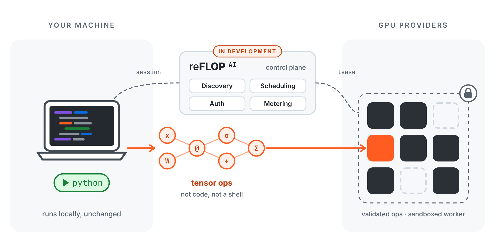
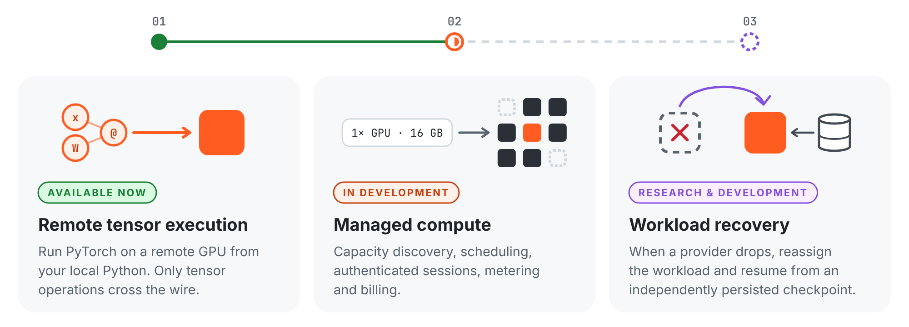
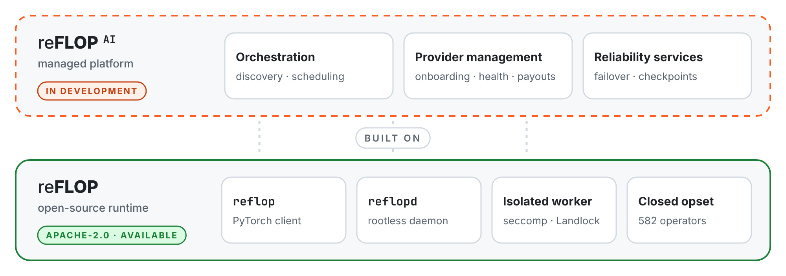

  <picture>
    <source media="(prefers-color-scheme: dark)" srcset="../assets/03_lockup_horizontal.png">
    
  </picture>
  
#
 
  **Making remote GPU computing feel local.**
 
  Building a developer-first, fault-tolerant distributed GPU compute network.
 
  [Website](https://reflopai.com) · [Open-source runtime](https://github.com/reflopai/reflop) · [Contact](https://reflopai.com/contact)

---
 
### Compute where you code.
 

  <picture>
    <source media="(prefers-color-scheme: dark)" srcset="../assets/overview-dark.png">
    
  </picture>

Your code stays on your machine; only validated tensor operations reach the GPU. That's **[reFLOP](https://github.com/reflopai/reflop)**, our open-source runtime.
 
### What we're building
 

  <picture>
    <source media="(prefers-color-scheme: dark)" srcset="../assets/building-dark.png">
    
  </picture>

The longer-term goal is a network where developers request compute, not machines—while providers contribute capacity without exposing general-purpose shell access to strangers.
 
### Built on open source
 

  <picture>
    <source media="(prefers-color-scheme: dark)" srcset="../assets/open-core-dark.png">
    
  </picture>

Explore the code, follow development, or contribute through the **[reFLOP repository](https://github.com/reflopai/reflop)**.
